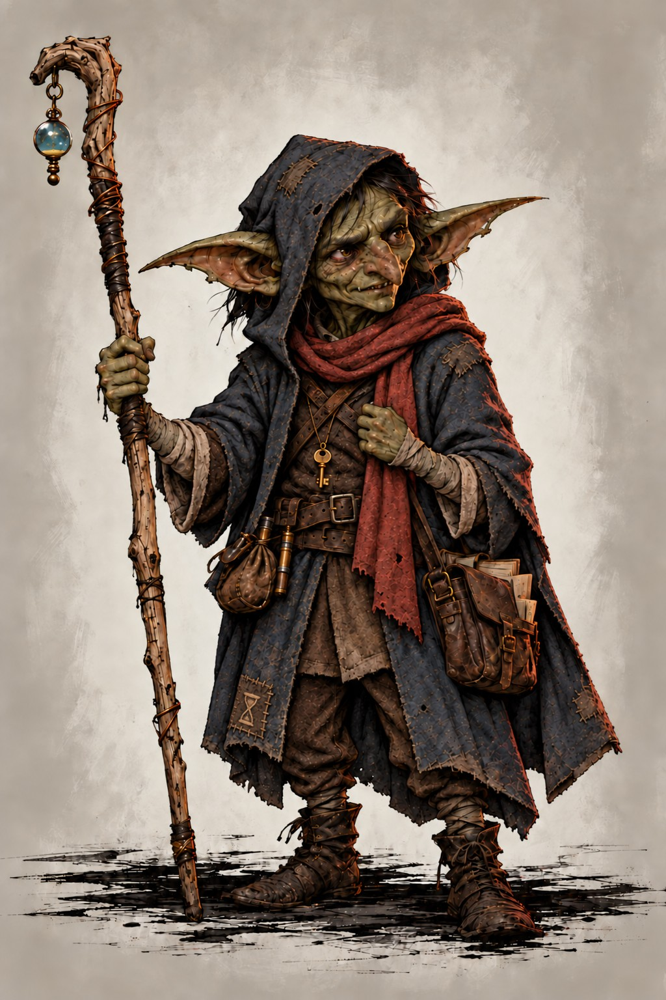

# Gaza — Goblin Chronurgy Wizard

*Started: 10 October 2026. Working concept; final build undecided.*

*Selected portrait: the first of the three latest variants, with the complete sand-colored hourglass inside the lower brown stitched patch.*

## Character at a glance

- **Name:** Gaza (G-A-Z-A).
- **Species:** Goblin.
- **Class:** Wizard, starting at level 5 to match the party.
- **Subclass direction:** Chronurgy Magic, subject to discussion with the DM.
- **Alignment:** Good-aligned and cooperative with the party.
- **Role:** Backup character, available if Kaelen dies or the player wants a change.
- **Interests:** Learning spells, collecting books, understanding magic, and helping companions.
- **Play preferences:** Time manipulation, useful interventions in other players' rolls, teleportation, and ordinary wizard spell versatility. No summon-focused play.

## Description

A small, curious goblin who has learned considerably more magic than his chronomancer master realises. He is already a capable level-five wizard, although his confidence does not match his knowledge. He serves as an obedient assistant and longs for his master's recognition. He fears losing his position and home if his secret study of restricted books is discovered.

He is eager to expand his knowledge. His bookish personality remains central even if Chronurgy is chosen instead of Order of Scribes.

A working proposal for his adventuring appearance, clothing, staff, keepsake, and mannerisms follows below. His exact age and ability scores remain open.

## Appearance and personal belongings — working proposal

*An initial visual direction for Gaza as an adventuring character, rather than his condition when the party finds him. These details are suggestions to refine together; they are not yet fixed character facts. His exact age remains open.*

### Selected portrait and visual refinements

The selected portrait above is the current visual reference. These refinements update the earlier appearance proposal where details differ:

- **Face:** a grimmer, clearly goblin face with angular, irregular features, a pronounced nose, and large ears. Avoid the earlier overly handsome or small-orc appearance; the grimmer look does not change his good intentions.
- **Clothing:** worn hooded clothing with fewer dangling shreds and clear, uncluttered shapes.
- **Staff:** tiny hints of chronomancy, with floating golden sand inside the staff's blue orb. This is cosmetic flavour and grants no additional ability.
- **Hourglass patch:** a complete sand-colored hourglass within the existing lower brown stitched patch, following the patch's angle and folds.
- **Key:** a very small time-dragon crest engraved on his ordinary-looking brass key. It leaves a possible story hook for the DM, with no powers or origin established.

### Face and build

Gaza is a small, lightly built goblin with moss-green skin, long expressive ears, and warm amber eyes. Short, unruly dark hair sticks up where he has run his fingers through it while thinking. One ear has a small notch; its origin is undecided.

His face is attentive and easy to read. When someone speaks, he looks at them closely, sometimes tilting his head as he works through an idea. His eyes brighten when he understands something, and his smile arrives before he has found the words to explain it.

### What he wears

He wears a practical, faded blue coat with a split hem that lets him move easily. Its sleeves are neatly rolled back from his hands, and the lining and pockets have been repaired with careful stitching. Underneath are a brown waistcoat, a plain linen shirt, and sturdy trousers tucked into well-kept ankle boots.

A soft rust-red scarf wraps around his neck. He pulls it higher when nervous or cold, and takes care of it even when he neglects his own comfort. The coat and scarf are belongings he has chosen and made comfortable for himself.

A leather belt carries his component pouch, a pencil, and a few small tools. His spellbook travels in a weatherproof satchel, with cloth wrapped around it and little paper tabs marking frequently consulted pages. He keeps useful scraps of notes, string, and spare buttons in separate pockets. He usually knows which pocket holds what.

### His staff

His staff is a slender length of pale ash, slightly taller than he is, with a natural curve near the top. The grip is wrapped in dark leather, worn smooth where his thumb rests. A narrow split in the wood has been carefully bound with copper wire.

At the head, a small loop of tarnished brass holds a cloudy blue orb, with tiny grains of golden sand floating inside as a subtle hint of chronomancy. It gives the staff a recognisable silhouette without making it elaborate. Tiny measuring marks run down one side, and a few handwritten reminders have been scratched into the wood.

He treats the staff as a familiar tool: leaning on it while reading, laying it within reach when he sleeps, and checking the copper binding when he is thinking. Its craftsmanship can become tidier as he gains confidence.

This is a proposed appearance for an ordinary wizard's staff or arcane focus, subject to the agreed equipment. The orb, brass loop, repairs, and floating golden sand are cosmetic flavour and grant no additional abilities.

### A unique personal item — the key without a lock

Gaza keeps a small, worn brass key on a cord beneath his scarf. He has no matching lock. He occasionally rubs its rounded head between his fingers while thinking.

One possible explanation is that it was the first small possession he chose to keep for himself. He likes the thought that somewhere there might be a door it opens. Whether it eventually connects to his past, an ordinary place, or nothing at all is left open for the DM and player.

The key is a personal keepsake, not a magical item, a working skeleton key, or a confirmed clue. Its exact origin remains undecided.

### Mannerisms that bring the appearance to life

- He pushes his sleeves back before concentrating on a problem, even when they are already rolled up.
- He carefully straightens bent pages and checks that his companions' belongings are out of the rain.
- When excited, he starts an explanation halfway through his thought, then backs up to supply the missing beginning.
- On night watch, he sits close to the light with the staff across his knees, making a sincere effort to look dependable.
- After a time correction, his usual attentive expression might briefly give way to a distant stare, damp forehead, or tight grip on the staff, consistent with the existing cosmetic physical tells.

### Short description for play

A small moss-green goblin with amber eyes and untidy dark hair wears a carefully mended blue coat and a rust-red scarf. A satchel of tabbed books rests against his hip. His pale wooden staff has a crooked head, copper repairs, and a cloudy blue bead held in a brass loop. He listens closely, fingers sometimes finding the little key beneath his scarf, and looks ready to help before he has quite worked out how.

## Personality

### A thinker with good intentions

Gaza is intelligent, observant, and curious. He thinks through problems and genuinely tries to fix things. He can be right or wrong; an unsuccessful idea does not mean he is foolish. His intelligence does not always translate into the right words or the best solution.

He is distinctive as an individual goblin. His character does not depend on treating other goblins as inherently unintelligent.

### Slightly naive and eager to help

His naivety lies in his eagerness to be useful and do the right thing. He wants to be someone his companions can count on, even when he volunteers for more than he comfortably handles.

For example, he might offer to take the night watch despite being scared of the dark. The offer is sincere; so is his fear. His efforts do not always work out as he hopes.

### Speech and learned servant manners

Gaza speaks with the eager, deferential manner of someone who has always been an assistant. He is quick to agree, offer help, and respond to requests with an earnest willingness to be useful. Serving his chronomancer master is familiar to him, and that same attitude carries into his interactions with the party.

Examples of his natural phrasing:

- “Oh yes, Master!”
- “Of course, Master!”
- “Yes, yes, of course—I can help.”
- “Oh yes, of course, Master! I’ll see to it.”
- “Yes, yes—I can help with that, sir.”
- “Master? If I may… I think I know this one.”
- “Oh—but, Master, that rune is still glowing. Perhaps let me check it first?”
- “Please, sir, let me carry that. You’ve enough to worry about.”
- “Was that right, Master? Shall I do it that way again?”
- “For me, sir? Oh. Thank you. I’ll take very good care of it.”

He longs for recognition from his master. His helpfulness is sincere, while his habit of putting others' requests first reflects the role he has grown up in. His master's appreciation of his work has not made theirs a family relationship.

This manner does not make him foolish or incapable of independent thought. He remains an intelligent, observant wizard with his own curiosity and ideas. Gaza sees himself as the lowest person in any hierarchy. He addresses the party and others with deferential titles such as “Master” or “sir”: “Yes, sir. Of course.” He assumes everyone else stands above him and does not consider himself anyone's equal. This describes his own sense of his place; how his companions respond remains open.

### Confidence and vulnerability

He has real magical knowledge, gained through study and practice, but limited experience outside the tower. He is neither a bumbling novice nor a calculating schemer concealing his intelligence. He knows what he is doing when he uses his time magic, even if the situation frightens him.

A possible character arc is learning that he can belong without always getting everything right, and becoming more confident in himself.

## Backstory — the overlooked assistant

*Selected direction: 15 October 2026. This is the backstory premise to develop; the open details below remain for discussion together.*

Gaza grew up serving a chronomancer in a wizard tower. He is an obedient assistant, accustomed to preparing materials, fetching books, and helping with the master's work. His upbringing is relatively comfortable, with an emphasis on assisting his master. His master values reliable service, but does not give Gaza the recognition he longs for. Their relationship is master and servant, without a family bond. Whether the service is formally slavery, and what freedom he actually has to leave, remain undecided.

“Of course, Master! Yes, yes—I can help.” That eagerness is sincere. Gaza is intelligent and capable, but being useful is the place he knows for himself. His master overlooks how much magical understanding he has acquired through watching and assisting.

At night, curiosity takes him into restricted sections of the library. A possible progression is that he gradually taught himself to read by matching familiar instructions and spoken explanations to written notes, then built up his wizardry through study and practice. The exact learning timeline remains open.

He wants to learn more and become more capable so that he can help Master better and finally earn recognition. Alongside that sincere motive, he discovers his own enjoyment of magic. He might spend hours on a spell with no obvious use for his duties and still explain it as preparation for helping.

Being caught could, in Gaza's mind, mean losing his assistant's position and being thrown out of the only home he knows. This preserves the fear of discovery and nightly sneaking. Expulsion is a feared consequence, not an established response from the master. During an eligible check, Gaza could deliberately use Chronal Shift, with the proposed tiny-rewind presentation, to try to avoid discovery. No new ability is granted.

With the party, the same obedient eagerness carries over. A possible development is learning to voice his own wishes and accept that companions value his thoughts and company as well as his help. He remains thoughtful, capable of disagreement, and more than a comic servant.

### A night in the restricted library

*Illustrative scene using the proposed tiny-rewind flavour for a successful Chronal Shift reroll.*

Gaza had promised himself one page. He was on his fourth.

He traced a line of cramped writing with one finger. The strange little diagram beneath it finally made sense. His ears lifted.

“Oh,” he whispered. “Oh, that's clever.”

He ought to go. Master would need him early.

The book was almost back on its shelf when the floorboard creaked beneath him. Footsteps stopped outside the library.

Gaza's stomach tightened. If they found him here—

He snapped his fingers: a sharp, very loud snap.

The book was back in his hands, inches from the shelf. He was living those last seconds again. This time, the board took his weight without a sound.

The footsteps continued down the corridor.

Gaza stood motionless, his fingers damp against the leather cover. Only he remembered the creak, the approaching discovery, and the snap.

He put the book away.

Then he glanced at its spine.

There had been another diagram on the next page.

“Just to be useful,” he murmured. “In case Master needs it.”

He drew the book out again.

### Still to explore

- How he came to the tower, how long he has served, and the precise terms of that service.
- What the master knows about his literacy and wizardry; overlooking his progress need not mean overlooking every spell.
- Why the library sections are restricted, and what the master would actually do if he discovered the studying.
- How he joins the party and gains a reason to keep adventuring. The circumstances of his departure remain undecided.
- Whether the earlier goblin-family search still interests us alongside this upbringing.
- The earlier assistant suggestion that he answers praise by offering more help is an optional mannerism, not yet a selected trait.

## Personal quest

He wants to expand his knowledge of wizardry, become more useful to his master, and earn recognition. What takes him beyond the tower, and how his goals develop with the party, remain for discussion.

Any larger quest remains open.

## Backstory thoughts — only a starting point

*These family-and-belonging ideas remain exploratory. They have not been selected as Gaza's personal quest and should be reviewed together in light of his assistant upbringing. Any of these ideas can change or be discarded.*

### Family and belonging

Perhaps Gaza grew up serving in the tower with little contact with his family or former community. How much he remembers, and how familiar he is with everyday goblin customs, remain open.

He might want to find the people he came from, partly to discover whether anyone remembers or missed him. He imagines that returning will feel like coming home, but the reunion may be more complicated: affection and unfamiliarity can coexist.

One possible arc is discovering that he can reconnect with his origins while also finding a home among his adventuring companions. Whether he returns, stays, or belongs in both places remains open.

### Possible hooks for the DM

- **A first lead:** someone recognises a name, keepsake, or fragment of a childhood memory and can point him towards his former community. Which clue he has, if any, is undecided.
- **An actual reunion:** a relative or old friend remembers him, but they have both changed. The encounter gives him someone to talk to and something concrete to choose.
- **A reason to stay involved:** someone from home needs help with a specific problem. The nature of that problem should fit the campaign rather than being fixed now.

These hooks work through relationships and ordinary events; they do not require anyone to know about Gaza's chronomancy.

### Questions to return to

- Does he remember particular people, or mostly a feeling of home?
- What makes him start looking, and what lead can he actually follow?
- What does he hope to find when he arrives?
- How would returning differ from his expectations?

His interest in learning spells remains part of his personality. A concrete person, place, or lead could give that curiosity and his wish to belong a playable direction.

## Chronurgy and the tiny rewind

### Deliberate, private corrections

Gaza notices something going wrong and deliberately tries that brief moment again. His private thought might be: “Ah, shit. We need to do this again.” This is an internal reaction, not an announcement to the party.

He understands the trick he is using. It can still fail: the new outcome is not guaranteed to be better.

### Only Gaza remembers

**Our proposed narrative house rule, pending DM agreement, is that only Gaza remembers the discarded version of the moment.** Everyone else experiences the final outcome as the only sequence of events that happened. They feel no rewind, remember no alternative, and have no reason to ask him to repeat a moment.

A mistake erased through a successful reroll is known only to Gaza. Uncorrected mistakes, or a worse second result, can still be visible to others. He retains a memory of what happened in that brief discarded moment, not general knowledge of what will happen next.

This proposed experience is for the characters within the story. The players and DM still resolve the actual reroll at the table.

### Why he cannot explain it — new story proposal

Gaza is willing to tell his companions about his time magic, but currently cannot. When he tries to explain the ability, an unknown higher power or temporal force rolls time back to roughly two seconds before he began explaining. The strain overwhelms him and he blacks out. It is draining rather than painful.

The rewind prevents the disclosure from reaching his companions. They do not retain the discarded explanation. What they observe of his blackout, and how long it lasts, remain for the DM to define. This replaces the earlier suggestion that he simply feels uncomfortable discussing it: his silence is imposed, not chosen out of shame, distrust, or uncertainty about his competence.

The identity, motives, and origin of the preventing force remain open. This is a proposed story restriction and house rule, not a published Chronurgy feature or an approved extra power.

#### Private decisions, not a group safety plan

Gaza knows his own ability and can take a personal risk with the thought that he might reverse an eligible moment if necessary. He still activates it in reaction to something happening, within the limits of the feature being used. Having this private fallback is not a guarantee of success or permission to undo anything.

His companions cannot knowingly plan around “Gaza will rewind us if it goes wrong.” He cannot tell them to take risks on that promise. He may still give a practical warning during an approved replay without explaining its source.

The players and DM know the mechanics; the intended restriction concerns character knowledge. Keeping that distinction is a shared table agreement, not something secrecy alone guarantees.

#### Possible growth — deliberately undecided

As Gaza gains experience and becomes more adept, he might eventually tolerate the strain, understand the restriction, or become able to explain his power. Whether that happens, how, and at what level remain open. No automatic unlock is agreed. For now, the intended story is that disclosure is blocked.

#### DM decisions and mechanical boundaries

- [ ] Agree whether this disclosure-blocking force belongs in the story.
- [ ] Define what counts as disclosure, including writing, hints, demonstrations, or magical communication.
- [ ] Define the blackout's duration, what companions observe, and what Gaza remembers afterwards.
- [ ] Decide whether the blackout is a narrative lapse or applies an actual condition such as Unconscious, and whether attempts impose mechanical Exhaustion or resource costs.
- [ ] Ensure the forced rewind cannot be triggered deliberately to gain extra useful rewinds, information, or restored resources.
- [ ] Decide how discovery by others is handled; the restriction on his explanations does not itself establish universal undetectability.
- [ ] Keep any future weakening or removal of the restriction open for later discussion.

No new Exhaustion cost, condition, or spending of Chronal Shift uses is assumed here. Ordinary Chronal Shift remains unchanged. The forced disclosure rewind is separate from the optional level-ten exploration rewind and is not available as an additional controllable ability.

### Physical tells

After a rewind, companions might notice that Gaza is suddenly sweating, looks drained, or seems unusually tired. They see the strain without knowing its cause; they do not remember the event that prompted it.

These are roleplay details, not added game penalties. In particular, ordinary Chronal Shift does not mechanically cause Exhaustion. The later Convergent Future feature does have an exhaustion cost.

### Example at the table

A companion's attempt goes wrong. Gaza remembers that version, silently makes his correction, and the check is rerolled. If the new result succeeds, the companion remembers succeeding. Gaza alone remembers the earlier failure, while someone might wonder why he suddenly looks so worn out.

### Chronal Shift — starting feature

- Uses a reaction after an attack roll, ability check, or saving throw succeeds or fails.
- Affects himself or a visible creature within 30 feet.
- Forces one reroll; the second result must be used.
- Two uses per long rest.
- Does not guarantee success or rewind an entire turn.

A guard's rolled Perception check or the goblin's own Stealth check could qualify. Passive Perception has no die to reroll. The reaction must be used at the eligible roll's resolution, not much later after its consequences unfold.

The “two or three seconds back” description is proposed flavour for this mechanic. Literal time travel beyond the feature would need a separate DM ruling.

## Spell and feature flavour — rules and homebrew status

### Published mechanics remain unchanged

Chronal Shift is a subclass feature, not a spell. Its reaction, eligible rolls, visibility and 30-foot range, two uses per long rest, and requirement to use the second result remain unchanged. Gaza cannot guarantee a better outcome.

### Cosmetic flavour

We describe the reroll as Gaza deliberately replaying a tiny moment, roughly two or three seconds. His private reaction might be “Ah, shit. We need to do this again.” Sweating or looking drained afterwards adds character without imposing Exhaustion or other penalties.

When Gaza deliberately rewinds a moment, he snaps his fingers with a sharp, very loud snapping sound. The snap belongs to the discarded moment and is erased with it, so only Gaza remembers hearing it afterwards, under the proposed only-Gaza-remembers interpretation. This gesture and sound are cosmetic flavour, not an additional mechanical requirement.

This description does not grant an actual time-reversal ability beyond the eligible reroll.

### Proposed narrative house rule — pending DM agreement

Only Gaza remembers the discarded outcome; everyone else experiences the replacement as the only event and feels no rewind. This is our proposed narrative interpretation, not a memory effect or guaranteed secrecy granted by the published feature.

If this secrecy or memory difference changes what characters can discover or act upon, that is a house rule to agree with the DM explicitly. It does not automatically erase unrelated memories, reveal additional future information, or make all of Gaza's magic undetectable. Players and the DM still know a reroll happened.

### Mechanical homebrew status

No mechanical changes are currently approved. The disclosure-blocking rewind and blackout are a new story restriction for DM discussion; any actual Exhaustion, condition, or costs must be defined separately. A separate optional Two-Second Rewind is proposed below as explicit mechanical homebrew. Until the DM approves defined versions, Gaza's published features remain unchanged.

### Individual spells — still to develop

So far, we have developed the flavour of Chronal Shift. Convergent Future also has a flavour entry below. Gaza's individual spells and the presentation of his remaining subclass features have not yet been worked out. Future entries should list the normal effect, Gaza's presentation, and any proposed rule change separately.

## Optional homebrew proposal — Two-Second Rewind

**Status: player request for discussion, not approved or part of the build.** This is a separate proposed ability, not an expanded interpretation of Chronal Shift. Its costs and limits below are an initial design suggestion, not an established balanced rule.

### Intended experience

During a stealth or exploration scene, Gaza can rewind the shared timeline by about two seconds, returning the immediate situation and everyone's positions to just before one brief event, without restoring character resources. Only Gaza remembers the discarded interval. He can then choose a different immediate response, including a short warning to his companions; the new outcome is not guaranteed. The goal is to change how the group handles a brief exploration scenario, not simply select one creature to reroll and not rewrite combat.

Narratively this affects everyone's time, rather than targeting one creature's die. At the table, the DM identifies one short, local event to replay; the group does not reconstruct simultaneous events across the whole world.

### Suggested starting limits

- **Proposed unlock:** Wizard level 10, subject to DM agreement. Gaza would not have this ability at his level-five start. Level 10 is a tentative milestone, not a settled balance decision. This would be an additional homebrew benefit alongside Arcane Abeyance unless the DM explicitly chooses a replacement or tradeoff; no published feature is currently being replaced.

- **Cost and frequency:** a reaction and one spell slot of level 3 or higher per use; two separate uses per long rest. The slot and rewind use remain spent after rewinding. Higher-level slots do not increase the duration or uses. This is the current proposed trial version, not a confirmed balanced rule.
- **Timing:** a reaction immediately after Gaza perceives the brief event, while conscious and able to react. No waiting to learn later consequences.
- **Scope:** initially available outside initiative only, for one short exploration event. No reversing combat turns, damage, death, spellcasting, or expended resources in this trial version. The DM must identify a clear starting point; if the interval cannot be resolved within these boundaries, this version cannot rewind it.
- **Changed choice:** Gaza may change his own immediate action, such as stopping before stepping into view or calling “Wait—guards! Stay behind the wall!” during the replay. Companions can respond to that new warning if there is time, without remembering the discarded timeline. He cannot give them instructions before the rewind's starting point, grant extra actions, or fit a long discussion into two seconds. Other creatures respond normally to the changed situation.
- **Resolution:** the DM decides which checks the new situation needs. No automatic success, no blanket reroll for the whole party, and no additional turns or actions.
- **No loops:** the same event cannot be rewound again, including by another time-reversal ability.
- **Information:** Gaza remembers only what he personally perceived during the discarded interval. No extra future vision. He may privately weigh a risk knowing he has a limited fallback, but cannot promise the party a rewind. Repeated testing of passwords, traps, conversations, or other outcomes remains outside the trial's intended use.
- **Visibility and memory:** only Gaza retaining the old timeline is explicitly part of this homebrew request. Physical strain may be visible; the ability does not make his other magic undetectable.

### Separate from Chronal Shift

The trial rewind has its own two uses per long rest. It does not spend or increase Chronal Shift's two uses. Ordinary Chronal Shift remains a reaction plus one of its own uses, with no spell slot cost. The optional rewind costs a reaction, one rewind use, and a spell slot of level 3 or higher.

This proposal supersedes the shared-pool idea. If the DM declines the add-on, the ordinary Chronal Shift character concept remains intact.

### Resources remain unchanged

The scenario can change, but characters do not recover hit points, spell slots, feature uses, consumed items, or other resources. Existing conditions and ongoing effects are not reset to gain additional benefits. Gaza's rewind cost always remains paid. Scenes involving damage, spellcasting, or resource expenditure within the discarded interval need an explicit DM boundary; they are excluded from the initial trial to avoid contradictory states.

### Stealth example

While the party approaches a castle, guards begin to spot them. Gaza spends the slot and rewind use to rewind to just before that moment. This time he gives a quick warning—“Stop! Behind the wall!”—and tries to prevent the exposure. Companions can react within the available time, but remember only this version. The DM resolves the changed positions, any required checks, and the guards' response. Two seconds might allow stopping or ducking behind nearby cover; it does not allow a full retreat or a new route. A warning can itself make noise, and detection remains possible.

### Open questions for the DM

- [ ] Approve a trial at all, and settle the proposed level-ten unlock.
- [ ] Confirm two separate uses per long rest, a reaction, and a level-3-or-higher slot per use.
- [ ] Decide whether this is an additional benefit or needs a tradeoff; no existing feature is currently replaced.
- [ ] Define the trigger when a guard notices the party: before an alarm, before initiative, and before later consequences are resolved.
- [ ] Define the replay boundary and how much movement, a brief warning, and companions' reactions fit into two seconds.
- [ ] Decide which checks are repeated or replaced when the party changes its approach; clarify interactions with Chronal Shift and group Stealth checks.
- [ ] Agree that only Gaza remembers the discarded interval, and discuss consequences of that extra information.
- [ ] Decide how physical tells and activation are noticed; cosmetic tiredness is not mechanical Exhaustion.
- [ ] Confirm how unchanged resources, conditions, and ongoing effects are handled; keep ambiguous cases outside the initial trial.
- [ ] Agree on a review point and how to revise or withdraw the ability if it causes problems.

### Things to test in play

Use a short agreed trial, such as two or three sessions after the ability becomes available. This is a suggested review period, not a requirement.

- [ ] **Castle approach:** can a quick warning and nearby cover plausibly change detection without guaranteeing escape?
- [ ] **Party agency:** can companions choose their response rather than Gaza deciding their actions?
- [ ] **Timing:** is it easy to identify and replay the last two seconds without reconstructing a whole scene?
- [ ] **Game flow:** does the rewind resolve promptly without lengthy group planning inside the replay?
- [ ] **Remaining tension:** do guards and hazards remain meaningful, with failure still possible?
- [ ] **Resource cost:** are two uses and the slot cost restrictive enough while still allowing enjoyable use?
- [ ] **Information exploits:** do deliberate tests of passwords, conversations, or traps create repeatable advantages?
- [ ] **Resource accounting:** are slots, HP, items, and uses tracked consistently with no refunds or duplication?

After each use, briefly note the trigger, changed choice, cost, outcome, and any ruling that was unclear. At the agreed review point, the DM and player can retain the trial, adjust its cost or frequency, narrow its scope, or remove it. No balance outcome is assumed in advance.

A fallback is ordinary Chronal Shift with the tiny-rewind description: no changed actions or positions. If the optional homebrew is rejected, Gaza's backstory and personality still work; the exclusive-memory flavour remains its own DM discussion.

## Later subclass milestones

| Wizard level | Feature summary |
|---|---|
| 3 on the 2024 Wizard, if approved | Chronal Shift and Intelligence added to initiative. The original subclass starts at level 2. |
| 6 | Momentary Stasis: briefly incapacitate and stop a creature on a failed Constitution save; damage ends the effect. |
| 10 | Arcane Abeyance: store a spell in a bead for someone else to release, including handling concentration. |
| 14 | Convergent Future: force a qualifying roll to succeed or fail, at the cost of exhaustion. |

Chronurgy comes from *Explorer's Guide to Wildemount*. The DM should confirm its use with the campaign's 2024 Wizard rules.

### Level 14 — Convergent Future: choosing a branch

#### Gaza's experience

Gaza glimpses a few possible versions of the immediate moment and deliberately pulls one into reality. Where Chronal Shift gave him another attempt, Convergent Future lets him select the branch corresponding to the roll's success or failure.

His private thought might be: “No. This is the version where you make it.” He need not say this aloud or explain what he has done.

For example, he glimpses a companion losing their grip and another possibility where their fingers catch the ledge. He draws the latter possibility into place as the companion makes the qualifying check. This describes that check's outcome, not control over everything that follows.

#### The strain of choosing

The feature's actual Exhaustion cost represents the effort of forcing a possibility into reality. Gaza might sweat, tremble, or struggle to catch his breath afterwards. These descriptions accompany the existing penalty; they do not add new penalties.

This differs from Chronal Shift's cosmetic tiredness: Convergent Future really does cause Exhaustion.

#### Published mechanics and flavour boundary

At wizard level 14, the feature uses a reaction when Gaza, or a creature he can see within 60 feet, makes an attack roll, ability check, or saving throw. It replaces the die roll with the minimum needed to succeed or one less than that number, chosen by Gaza. Each use causes one level of Exhaustion and costs no spell slot. Exhaustion gained this way can be removed only by finishing a long rest; each such rest removes one level of it.

The possible-futures description is flavour for that immediate qualifying roll. It does not grant ongoing foresight, information about unrelated futures, control of an entire scenario, or the separate optional exploration rewind. Other rules that affect the resolved outcome still apply. No mechanical changes to Convergent Future are proposed here.

The DM should confirm how this older subclass's Exhaustion cost works with the campaign's 2024 rules.

## Discuss with the DM

- Approval and adaptation of Chronurgy to the 2024 Wizard.
- Whether to trial the separate Two-Second Rewind homebrew proposal, including its costs, scope, and memory effect.
- Whether the DM agrees to the core flavour: only Gaza remembers the discarded moment; other characters feel no change and know only the final outcome.
- Approval and boundaries for the new disclosure-blocking force, forced rewind, and blackout; any mechanical penalties require explicit agreement.
- Whether Gaza could later overcome that restriction remains deliberately open.
- How subtle physical tells are portrayed without adding penalties to Chronal Shift.
- Timing of rerolls during stealth and detection scenes.
- How much the chronomancer master knows about Gaza's level-five wizardry and secret study of restricted books.
- How and why Gaza leaves the tower and joins the party.
- Starting spellbook, equipment, and whether he takes or is given books from the tower.

## Potential feat — Lucky: two versions to consider

**Status: a feat Gaza's player likes and wants to consider; not a final build choice.** The preferred idea so far is the 2014 *Player's Handbook* version; the 2024 version is recorded below as an alternative. Choose one version with the DM, not both. Neither is a final build choice.

### 2014 version — published mechanics

- No racial prerequisite: Gaza can qualify as a goblin.
- Three luck points; finishing a long rest restores all spent points. Each use spends one point.
- On Gaza's own attack roll, ability check, or saving throw, he can roll an additional d20 and choose which die to use. He may spend the point after rolling, but before the outcome is determined.
- When an attack roll is made against Gaza, he can roll an additional d20 and choose whether the attack uses the attacker's die or his. Normally he would choose the lower die; the attacker's modifiers still apply, so a miss is not guaranteed.
- Using Lucky requires no action or reaction and no spell slot.

### Limits and an inn example

Lucky cannot change an attack against an ally or an NPC's Persuasion or Deception check aimed at the party. It can improve Gaza's own Insight check to notice a lie. It is not a general power to make another creature reroll.

### Possible chronomancy flavour

Gaza glimpses an unwanted version of a brief moment and quietly selects another: “No, not that one.” Others might see a lucky dodge or a better-timed response. This is flavour for the existing die choice, not an extra rewind, changed action, or guaranteed success. Any exclusive-memory or secrecy effects remain the separate narrative proposals above.

Lucky has its own three-point pool, separate from Chronal Shift and the optional exploration rewind. Its lack of a reaction cost could make it a useful additional personal correction.

Rules reference: *Player's Handbook* (2014), p. 167; [official Sage Advice on Lucky](https://www.dndbeyond.com/sources/dnd/sac/sage-advice-compendium#Lucky).

### 2024 version — alternative

The 2024 *Player's Handbook* makes Lucky an **Origin feat**, with no racial prerequisite.

- Luck points equal to Gaza's Proficiency Bonus: 2 at character levels 1–4, 3 at 5–8, 4 at 9–12, 5 at 13–16, and 6 at 17–20. A long rest restores spent points.
- Spend one point when Gaza rolls a d20 for his own attack roll, ability check, or saving throw to give himself Advantage on that roll.
- Spend one point when a creature rolls a d20 for an attack against Gaza to impose Disadvantage on that roll.
- No action, reaction, or spell slot cost.
- It does not affect an ally's roll, an attack against an ally, or an NPC's social check aimed at the party.

**Difference to remember:** 2014 Lucky lets Gaza roll an additional die and choose which result to use; 2024 Lucky applies normal Advantage/Disadvantage and scales its point pool with level. If Gaza already has Advantage, the 2024 feat does not add another layer of Advantage. Advantage and Disadvantage cancel normally.

The same chronomancy flavour could work: a glimpse of an unwanted possibility followed by a quiet adjustment. No actual rewind, guaranteed outcome, exclusive memory, or secrecy is granted by the feat.

At Gaza's planned level-five start, either version has three points per long rest. Acquisition still needs to fit the agreed background/feat choices; an Origin label is not an automatic extra feat.

Rules reference: *Player's Handbook* (2024), p. 201; [official guide to 2024 Origin feats](https://www.dndbeyond.com/posts/1785-the-backgrounds-and-origin-feats-in-the-2024).

## Other feat ideas — not chosen

These ideas were discussed but have not been selected or added to the build:

- **Alert**, especially the 2024 version.
- **Fey Touched**.
- **Bountiful Luck**, which would require the DM to waive its halfling prerequisite for Gaza.

## Build decisions still open

Background, ability scores, Origin feat, level-four choice, cantrips, prepared spells, and spellbook contents.

Evoker, Diviner, and Order of Scribes remain alternatives if Chronurgy does not work for the table. Abjurer, Enchanter, Illusionist, Necromancer, Transmuter, Graviturgy, and Bladesinger have been ruled out for this character. War Magic does not fit the desired play style; Conjurer's teleportation appealed, but its summon focus did not.
